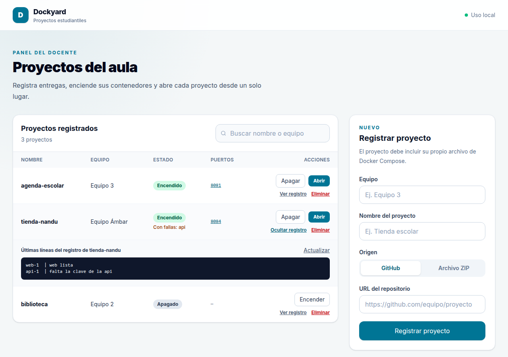

# Manual de usuario de Dockyard

Dockyard te permite registrar los proyectos de tus estudiantes, encenderlos, verlos funcionando y apagarlos desde el navegador, sin usar la terminal.

## Abrir la herramienta

Abre en el navegador http://localhost:4300. Dockyard arranca sola al encender la PC; no hace falta ejecutar nada. Por seguridad, solo funciona desde esa PC.

Si la página no carga, abre una terminal en la carpeta de Dockyard y ejecuta `./install.sh`.

Al reiniciar la PC, Dockyard vuelve solo, pero los proyectos quedan apagados y hay que encenderlos de nuevo. La excepción son los que declaran una política `restart` en su compose.

## Registrar un proyecto

En el panel **Registrar proyecto**, llena **Equipo** y **Nombre del proyecto**, elige el **Origen** y presiona **Registrar proyecto**. Cada proyecto se registra una vez. Dockyard ajusta el nombre a un formato válido: por ejemplo, `Tienda Equipo 3` queda como `tienda-equipo-3`.

**Origen GitHub.** Pega la **URL del repositorio**, que debe empezar con `https://` y ser pública (por ejemplo, `https://github.com/equipo3/tienda`). Dockyard descarga el código.

**Origen Archivo ZIP.** Elige el ZIP que te entregó el equipo, de 200 MB como máximo. Dockyard lo descomprime.

En los dos casos, el proyecto debe traer su archivo compose. Reparte entre los equipos la [Guía para estudiantes](guia-estudiantes.md) para evitar problemas. Toda la documentación se puede leer dentro de Dockyard, en la sección **Documentación**.

### Revisar antes de encender

Al registrar un proyecto, Dockyard lo revisa sin ejecutarlo. Si encuentra algo, la fila del proyecto muestra **Revisar antes de encender** con la lista de avisos. Por ejemplo, que el proyecto pide control de la PC, que monta carpetas de fuera de su carpeta o que trae claves o respaldos de base de datos.

Los avisos no impiden encender: tú decides. Si no entiendes uno, pregúntale al equipo antes de encender el proyecto. Si avisa de claves, pídele al equipo que las cambie y que las quite del proyecto, porque ya quedaron expuestas.

Que no aparezcan avisos no garantiza que el proyecto sea seguro, así que registra solo proyectos que conozcas.

## Buscar, encender, apagar y abrir

- **Buscar:** escribe parte del nombre del proyecto o del equipo en **Buscar nombre o equipo**. No importan las mayúsculas ni las tildes.
- **Encender:** la primera vez puede tardar varios minutos, porque Docker descarga y construye las imágenes del proyecto. Mientras tanto, el botón dice **Encendiendo…** y debajo del proyecto se ve qué está haciendo Docker, cuánto lleva y sus últimas líneas. Puedes recargar la página sin interrumpirlo, pero si falla mientras tanto no verás el motivo: usa **Ver registro**. Las siguientes veces es rápido.
- **Abrir:** cuando el proyecto está **Encendido**, este botón abre en otra pestaña la dirección donde funciona (por ejemplo, http://localhost:8081). Si no abre la página correcta, prueba con los números de la columna **Puertos**: cada uno es un enlace.
- **Apagar:** detiene el proyecto sin borrar nada. Sus datos se conservan para la próxima vez.
- **Ver registro:** muestra las últimas líneas que escribió el proyecto. Sirve para saber por qué falla y compartirlo con el equipo.
- **Eliminar:** borra el proyecto, su código y sus datos, y libera su nombre. Para confirmar hay que escribir el nombre del proyecto, porque no se puede deshacer.

La tabla se actualiza sola cada 15 segundos. Si un proyecto aparece **Encendido** con el aviso **Con fallas**, uno de sus servicios se cayó; usa **Ver registro** para ver el motivo.

Debajo de **Encendido** se indica si la página del proyecto contesta:

- **La web responde:** Dockyard recibió una respuesta. No revisa si cada función sirve, pero la página está arriba.
- **La web aún no responde:** es normal unos segundos o minutos después de encender, mientras arranca. Si no cambia, usa **Ver registro**.
- **La web responde con error:** el servidor contesta, pero falla. Suele ser un problema del proyecto, como una base de datos que no conecta.

Se comprueba solo el puerto que usa **Abrir**.

## Problemas frecuentes

| Mensaje | Qué pasa | Qué hacer |
|---|---|---|
| El puerto 8081 ya está en uso por el contenedor … | Otro proyecto encendido usa el mismo puerto | Apaga el otro proyecto y vuelve a intentar, o pide al equipo que cambie el puerto en su compose |
| El nombre de contenedor … ya lo usa … | Dos proyectos fijan el mismo `container_name` en su compose | Pide al equipo que lo quite de su compose |
| El nombre … ya lo usa otro proyecto de Docker | Hay contenedores con ese nombre fuera de Dockyard | Usa otro nombre al registrar |
| Dockyard solo acepta peticiones desde su propia página | Se intentó usar desde otra página o dirección | Abre http://localhost:4300 en esta PC |
| Docker no responde | El servicio de Docker está apagado | En una terminal: `sudo systemctl start docker` |
| El proyecto tardó más de 10 minutos en encender | La descarga o la construcción de imágenes es muy lenta | Revisa la conexión a internet y vuelve a intentar |
| El proyecto se encendió, pero sus contenedores se detuvieron enseguida | El proyecto tiene un error propio; el mensaje muestra las últimas líneas de su registro | Comparte ese mensaje con el equipo para que lo corrija |
| No se encontró un archivo compose en la raíz del proyecto | El proyecto no cumple los requisitos | Pide al equipo que agregue su `compose.yaml` en la raíz |
| No se pudo clonar el repositorio … | La URL está mal o el repositorio es privado | Revisa la URL o pide al equipo que haga público el repositorio |
| Los contenedores se borraron, pero el proyecto dejó archivos sin permiso de borrado | El proyecto creó archivos como administrador | Ejecuta en una terminal el comando `sudo rm -rf …` que indica el mensaje y presiona **Eliminar** otra vez |
| No se puede conectar con Dockyard | La herramienta no responde | Recarga la página; si sigue igual, ejecuta `./install.sh` en la carpeta de Dockyard |
| No se pudo descomprimir el archivo | El ZIP está dañado o no es un ZIP | Pide al equipo que lo vuelva a generar |
| Ya existe un proyecto con ese nombre | Ya registraste un proyecto con ese nombre, o quedó su carpeta | Usa otro nombre, por ejemplo agregando el número de equipo |
